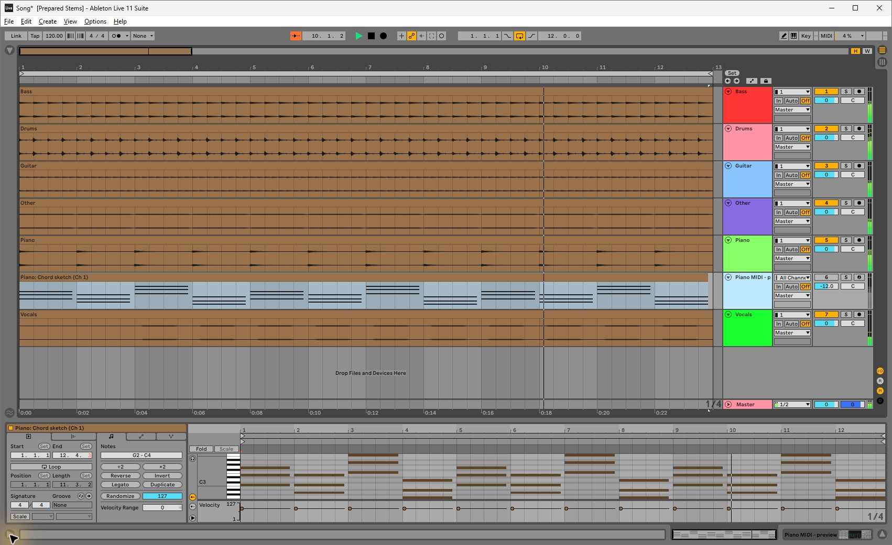
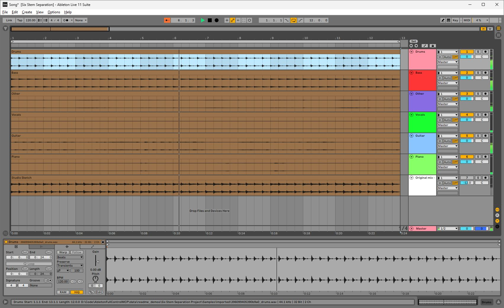
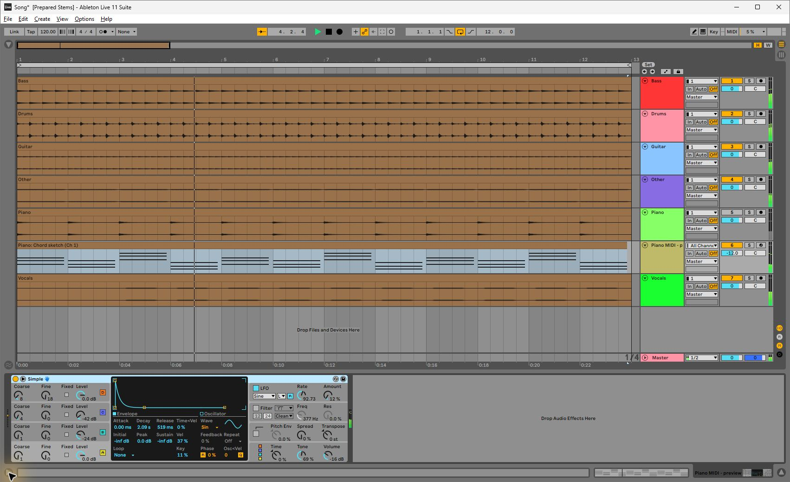

# Ableton MCP demos

These are actual Ableton Live 11.3.43 window captures. Project preparation, model separation, transport, mixer changes and sound-design actions ran through the MCP server. Computer Use framed the views, captured the screenshots, and opened/saved demonstration copies. The screenshots contain no composited interface elements.

The two project-import demos are a **development preview**. They require a checkout that registers `song_prepare_project`, `song_import_job_status` and `song_verify_imported_project`; this documentation update does not ship that implementation. Instrument and transport tools are documented in the [tool reference](TOOLS.md).

The source material is an original 24-second, twelve-bar sketch at 120 BPM in 4/4. It is generated locally by [make_demo_sources.py](../examples/make_demo_sources.py): six synthetic audio parts, a stereo mix, and a 36-note companion MIDI file. The part labeled Vocals is a synthesized melody, not a human recording. No account or external media is needed to generate these sources. Demucs may fetch its model weights on first use.

## Prepared stems and companion MIDI

> “Prepare this folder of stems and MIDI as a Live project at 120 BPM in 4/4. The source downbeat is at zero. Keep the MIDI muted until I audition it.”



The import creates six audio tracks and a paired MIDI track with a stock Operator preview instrument. All audio starts at the shared source origin, without warping. The screenshot shows playback and the imported notes, with the MIDI track muted. Track colors and the twelve-bar playback loop were applied for the demonstration after verification.

The same prepared-stem workflow accepts a local Suno export ZIP or folder; it does not run separation again. This screenshot uses generated WAV/MIDI fixtures rather than a Suno download.

Generate the original fixtures from the repository root after installing the project dependencies:

```powershell
python examples/make_demo_sources.py data/readme_demo_sources
```

The destination must be new. Call this MCP tool with absolute paths appropriate to your machine:

```json
{
  "tool": "song_prepare_project",
  "arguments": {
    "source_paths": ["D:/Music/demo_sources/prepared_stems"],
    "destination": "D:/Music/Prepared Stems Project",
    "source_mode": "prepared_stems",
    "bpm": 120,
    "time_signature": [4, 4],
    "downbeat_sec": 0
  }
}
```

The default response returns a job ID. Poll `song_import_job_status`; background preparation can include Live verification. Before a verification run, stop transport and preserve any work in the active set. The importer needs Live 11 track scaffolding: in the development checkout, `song_use_import_template(template_als_path)` caches the currently loaded set after it has been saved by the running Live build. The demo used that native reference for its schema and compatibility metadata.

In this capture, `song_verify_imported_project` confirmed playback, all 36 MIDI notes, the MIDI instrument preview, and reopening both the original and a relocated project. The result remained `needs_review`: repeated chord onsets could not establish a unique audio/MIDI offset. Successful playback does not silently certify uncertain musical timing.

## One recording to six stem tracks

> “Take Studio Sketch.wav, separate it into six stems, and prepare a project with the original mix muted for reference.”



```json
{
  "tool": "song_prepare_project",
  "arguments": {
    "source_paths": ["D:/Music/demo_sources/Studio Sketch.wav"],
    "destination": "D:/Music/Six Stem Separation Project",
    "source_mode": "separate_recording_6stems",
    "bpm": 120,
    "time_signature": [4, 4],
    "downbeat_sec": 0
  }
}
```

This example ran the actual `htdemucs_6s` model. The six outputs are Drums, Bass, Other, Vocals, Guitar and Piano; a seventh track contains the muted original mix. Playback, source duration, relative media paths, compatible template metadata and both original/relocated reopening passed verification as `ready_audio_only`. Separation results depend on the source: the model's categories do not guarantee perfect isolation or recovery of the original synthetic parts.

## Change an instrument while auditioning MIDI

> “Mute the recorded piano, audition its MIDI part, and make Operator warmer.”



The demonstrated calls were `track_set_mute`, `view_select_device`, and:

```json
{
  "tool": "sound_apply_descriptor",
  "arguments": {
    "track_index": 5,
    "device_index": 0,
    "descriptor": "warm",
    "intensity": 0.25,
    "dry_run": false
  }
}
```

Readback through `device_get_parameters` confirmed Tone changed from about 77% to 69%, and normalized Filter Freq from 0.438 to 0.394. The preset's filter was off, so the cutoff edit was stored but not active in the sound. The tool returned `partial`, reporting that its `B Level` rule did not match the installed Operator parameter name. The screenshot shows the actual result, not a claim that every rule applied.

The playback examples also used `live_set_loop`, `live_jump_to_beat`, `live_play`, `live_stop`, `view_select_track`, `track_set_name`, and `track_set_color_index`. Their effects are visible in the transport, track headers, meters and selected device.

## Capture notes

The screenshot assets are native JPEG window captures. The source audio, model outputs, Live projects and detailed MCP logs remain generated local data; they are not embedded in this repository. The fixtures are available through the generator above. UI saving of a demonstration copy does not imply that Live 11 exposes a native MCP save API.
